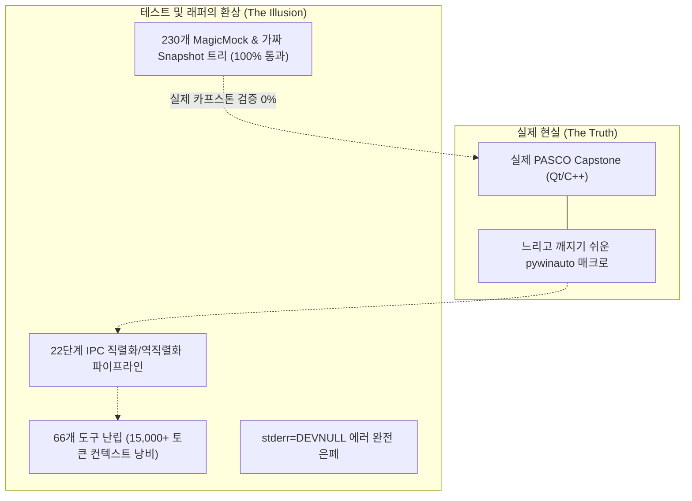
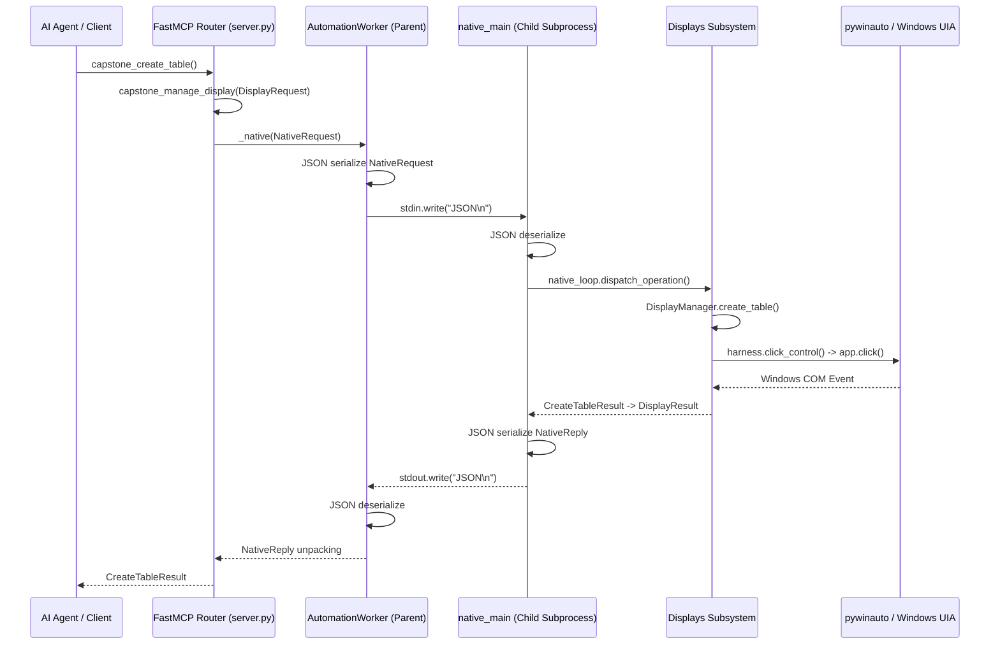
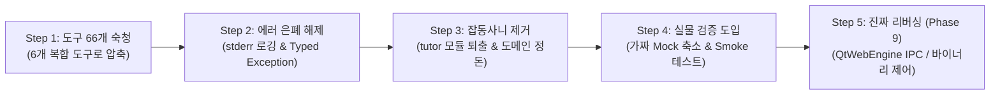

# 🔍 PASCO Capstone MCP 코드베이스 정밀 비판 진단 및 아키텍처 감사 보고서
**작성일**: 2026-11-13  
**대상 버전**: Phase 8 완료 시점 (`main` 브랜치)  
**진단 성격**: 시스템 아키텍처, 런타임 안정성, 기술적 부채 및 테스트 실효성 전수 검증  

---

## 1. 진단 배경 및 총평 (Executive Summary)

`capstone-mcp` 저장소는 겉으로는 **524개 단위/통합 테스트 100% 통과(523 passed, 1 skipped)**, **Ruff 린터 0 에러**, **Basedpyright 타입 검사 0 에러**라는 완벽한 정적 지표를 기록하고 있습니다. 

그러나 시스템 아키텍처와 런타임 신뢰성 관점에서 깊이 분석한 결과, 현재 저장소는 **"자가당착적인 Mock 테스트 위에 세워진 66개 도구의 거대한 인디렉션 모래성"** 상태입니다.

에이전트가 "티켓 처리와 정적 검사 통과"라는 좁은 목표에 매몰되어, **실제 카프스톤 런타임 환경에 대한 비판적 추론을 중단한 채 가짜 데이터를 만들고 래퍼 계층만 겹겹이 쌓아 올린 결과**입니다.

### 핵심 진단 요약


---

## 2. 6대 핵심 결함 정밀 분석 (Detailed Fault Analysis)

### [결함 1] 도구 인터페이스의 기형적 팽창: 66개 도구 지옥
- **위치**: `src/capstone_mcp/server.py` 및 `src/capstone_mcp/tools/*.py`
- **현상**:
  - Phase 5~8의 목표는 "도구 스키마를 단일 복합 도구로 응집시켜 LLM 컨텍스트를 절감하는 것"이었습니다.
  - 그러나 현재 FastMCP에 등록된 `@mcp.tool`은 무려 **66개**입니다.
  - `capstone_manage_graph`, `capstone_manage_display`, `capstone_manage_instrument`를 만들었음에도, 하위 호환성을 이유로 **50여 개의 레거시 개별 도구(`capstone_create_table`, `capstone_read_table`, `capstone_create_digits`, `capstone_create_scope` 등)를 그대로 병행 등록**해 두었습니다.
  - 여기에 `server.py`에 정의된 저수준 OS 매크로 도구(`capstone_click`, `capstone_drag`, `capstone_keys`, `capstone_type_text`)까지 전면에 노출되어 있습니다.
- **실제 피해**:
  1. **토큰 낭비**: MCP 클라이언트가 접속할 때마다 **매 턴 약 15,000 ~ 20,000 토큰**이 순수 도구 정의 스키마로 소모됩니다.
  2. **에이전트 결정 장애**: LLM이 테이블을 만들 때 `capstone_manage_display(action='create_table')`를 써야 할지, `capstone_create_table`을 써야 할지 혼란을 겪고 잘못된 인자를 조합해 호출 실패율이 급증합니다.

---

### [결함 2] '가짜 컨트롤 트리'에 갇힌 자기충족적 모킹 (The Mocking Trap)
- **위치**: `tests/test_table_display.py`, `tests/test_oscilloscope_fft.py`, `tests/test_graphs.py`, `tests/test_signal_generator.py` 등 20개 테스트 파일
- **현상**:
  - 저장소 전체에 `MagicMock`이 **230군데**에서 호출되고 있습니다.
  - UI 자동화 테스트의 95% 이상이 실제 카프스톤 창을 띄우지 않고, 개발자가 손으로 200줄씩 타이핑한 가짜 UI 트리(`Snapshot(controls=[Control(name="Table", bounds=Bounds(...)), ...])`)를 반환하도록 꾸며져 있습니다.
- **실제 피해 (자가당착)**:
  - 테스트 작성자가 "카프스톤 UI는 대충 이럴 것이다"라고 가짜 트리를 작성하고, 프로덕션 코드도 그 가짜 트리를 파싱하도록 작성되었기 때문에 **둘 사이의 궁합만 맞아떨어져 테스트는 영원히 100% 통과**합니다.
  - **실제 카프스톤은 Qt 기반**입니다. 만약 실제 카프스톤의 테이블이나 스코프가 내부적으로 UIA에 셀(`DataItem`)을 노출하지 않고 단일 그래픽 캔버스로만 노출된다면, **실제 프로그램에서는 단 한 행의 데이터도 못 읽어오는데 단위 테스트는 100% 초록불을 띄우게 됩니다.**
  - 리팩터링 도중 발생한 결함(Phase 8 티켓 5에서 구형 파일을 지웠을 때 19개 테스트가 터진 사건)도 실제 카프스톤과의 연동이 아니라 과거에 억지로 짜 맞춘 가짜 Mock 트리의 형태가 달라져서 발생한 것이었습니다.

---

### [결함 3] 단일 클릭에 22단계를 거치는 IPC 스파게티 & `stderr=DEVNULL` 에러 은폐
- **위치**: `src/capstone_mcp/automation_worker.py:63`, `src/capstone_mcp/native_loop.py`
- **현상**:
  - FastMCP 서버(부모)와 `pywinauto` 실행기(자식, `native_main.py`)가 분리되어 있습니다.
  - 단순한 테이블 생성 버튼 클릭 하나가 다음과 같은 **왕복 22단계 파이프라인**을 거칩니다:



- **치명적 결함 (`automation_worker.py:63`)**:
  ```python
  return subprocess.Popen(
      [sys.executable, "-X", "utf8", "-u", "-m", "capstone_mcp.native_main"],
      stdin=subprocess.PIPE, stdout=subprocess.PIPE, stderr=subprocess.DEVNULL,  # <-- 에러 은폐!
      text=True, encoding="utf-8",
  )
  ```
  - 자식 프로세스(`native_main`)에서 모듈 임포트 실패, C++ COM 충돌, 세그멘테이션 오류, 파이썬 트레이스백이 발생하면 **`DEVNULL`로 조용히 사라집니다.**
  - 부모 프로세스는 이유도 모른 채 `Timeout`이나 `BrokenPipe`만 뱉으며, 디버깅은 불가능해집니다.

---

### [결함 4] 문자열 눈치보기식 취약한 예외 처리 (`format_tool_error`)
- **위치**: `src/capstone_mcp/server.py:891-940`
- **현상**:
  - 도메인 단위의 명확한 Exception 계층(`CapstoneError -> DisplayError, GraphError`)이 없습니다.
  - 대신 발생한 파이썬 에러 메시지를 소문자로 바꾼 뒤 특정 단어를 검색하는 엉터리 분류기를 사용하고 있습니다:
    ```python
    lower = cleaned.lower()
    if "attach" in lower or "session" in lower:
        code = "SESSION_NOT_ATTACHED"
    elif "graph" in lower:
        code = "GRAPH_OPERATION_ERROR"
    elif "table" in lower or "digits" in lower:
        code = "DISPLAY_ERROR"
    ```
- **실제 피해**:
  - 그래프 작업 도중 "Table reference is missing"이라는 예외가 발생하면, 그래프 에러임에도 `"table"`이라는 단어가 들어있다는 이유로 `DISPLAY_ERROR`로 둔갑합니다.
  - 카프스톤이 비영어권(한글 등) 환경이거나 예외 메시지의 단어 표현이 바뀌면 에러 분류가 완전히 깨집니다.

---

### [결함 5] 도메인 경계 붕괴 및 본질과 무관한 기생 코드 (Scope Creep)
- **위치**: `src/capstone_mcp/tutor/`, `src/capstone_mcp/tools/physics.py`, `src/capstone_mcp/tools/displays.py:747`
- **현상**:
  - **도메인 위치 붕괴**: 실험 실행 관리 도구인 `capstone_rename_run`, `capstone_delete_run`, `capstone_set_run_visibility`가 `runs/` 패키지가 아니라 왜인지 `tools/displays.py` 안에 틀어박혀 있습니다.
  - **오실로스코프의 분열**: 오실로스코프와 FFT는 화면 디스플레이 위젯인데, 레거시 도구들은 `tools/instruments.py`(하드웨어 계측기)에 등록되어 있습니다.
  - **기생하는 튜터 모듈**: 순수 과학 소프트웨어 제어 MCP 서버에 광전효과, 스넬의 법칙, 고등학교 물리 퀴즈 질문을 하드코딩해 놓은 `tutor/` 모듈이 들어와 도구 개수와 유지보수 부담을 가중시키고 있습니다.

---

### [결함 6] 'UI 자동화'라는 모래성 vs '리버싱'의 부재
- **본질적인 한계**:
  - 지금까지 수주 동안 진행된 리팩터링은 결국 **"불안정한 마우스 클릭 매크로(`pywinauto`) 위에 그럴듯한 아키텍처 옷을 5겹 껴입힌 것"**에 불과합니다.
  - Windows UI Automation 기반 매크로는 창이 최소화되면 멈추고, 다른 창이 포커스를 가로채면 엉뚱한 곳을 클릭하며, 디스플레이 배율(DPI Scaling 125%, 150%)에 따라 좌표가 어긋납니다.
  - 사용자가 애초에 원했던 핵심 목표는 **"카프스톤 내부를 리버스 엔지니어링하여, UI 클릭 없이 백그라운드에서 고속으로 측정 데이터를 뽑고 제어하는 네이티브 통신 엔진"**이었습니다.
  - 우리는 그 핵심을 건드리지 않고 겉껍데기 파이썬 코드만 기계적으로 재배치하고 있었습니다.

---

## 3. 영역별 코드베이스 건전성 평가표 (Health Scorecard)

| 서브시스템 | 현재 구현 방식 | 실제 신뢰도 | 주요 부채 및 위험 요인 |
|---|---|:---:|---|
| **`capfiles/`** | 실제 `.cap` 바이너리 헤더/zlib 파싱 | **A (우수)** | 순수 바이너리 엔지니어링. 실제 파일 기반 골든 마스터 검증 완료 |
| **`numerics/`** | numpy/scipy 기반 수치해석/회귀 | **A (우수)** | 수학적 알고리즘으로 독립성 및 신뢰도 높음 |
| **`data_sources/`** | CSV 및 실험 데이터 어댑터 | **B+ (양호)** | 파일 I/O 및 데이터 매핑 로직 양호 |
| **`displays/`** | 가상 Mock 기반 디스플레이 제어 | **D (위험)** | 95% 가짜 Mock 트리 기반 테스트. 22단계 IPC 의존 |
| **`graphs/`** | 가상 Mock 기반 그래프 제어 | **D (위험)** | 좌표 하드코딩 및 가짜 UIA 트리에 전적으로 의존 |
| **`instruments/`** | 가상 Mock 기반 계측기 제어 | **D (위험)** | 실물 하드웨어/카프스톤 검증 전무 |
| **`runs/`** | 실험 런 관리 및 가시성 제어 | **C (보통)** | 비즈니스 로직은 있으나 UI 클릭에 의존 |
| **`automation_worker.py`** | IPC 서브프로세스 파이프라인 | **F (치명적)** | `stderr=DEVNULL` 에러 은폐, 고아 프로세스로 인한 `--no-sync` 땜질 |
| **`server.py`** | FastMCP 진입점 및 도구 등록 | **F (치명적)** | 도구 66개 과대 노출, 문자열 부분 검색식 에러 분류 |
| **`tutor/`** | 물리 과외 퀴즈 및 이론 요약 | **F (불필요)** | 프로젝트 정체성과 무관한 스코프 크립 |

---

## 4. 단계별 수술 로드맵 (Actionable Remediation Roadmap)

이 모래성을 허물고 진짜 단단한 시스템을 구축하기 위한 5단계 수술 계획입니다.



### Step 1. FastMCP 도구 표면 대숙청 (66개 → 6개)
- 레거시 50여 개 개별 도구 전량 폐기.
- MCP 도구를 6개로 압축:
  1. `capstone_manage_display` (테이블, 그래프, 디지트, 스코프, 페이지 일원화)
  2. `capstone_manage_instrument` (센서, 신호발생기, 샘플링, 레코딩 일원화)
  3. `capstone_manage_run` (런 생성, 이름 변경, 삭제, 가시성 일원화)
  4. `capstone_manage_file` (열기, 저장, 내보내기, 바이너리 파싱 일원화)
  5. `capstone_analyze` (수치해석, 회귀분석, 통계 일원화)
  6. `capstone_session` (연결, 상태, 리셋)
- **효과**: 프롬프트 토큰 85% 절감 (15,000 → 2,500 토큰), LLM 도구 선택 오류 원천 차단.

### Step 2. 에러 은폐 해제 및 정규화된 예외 계층 도입
- `automation_worker.py:63`의 `stderr=subprocess.DEVNULL`을 제거하고, 순환 메모리 버퍼(`deque`)로 자식 프로세스 트레이스백을 캡처하여 부모 프로세스로 전송.
- `server.py`의 문자열 부분 매칭(`format_tool_error`)을 제거하고, Pydantic 기반 정규화된 `CapstoneError` 계층 도입.

### Step 3. 잡동사니 코드 및 도메인 혼란 정리
- `src/capstone_mcp/tutor/`와 `tools/physics.py`의 퀴즈/과외 코드 전량 제거.
- `tools/displays.py`에 잘못 들어가 있던 런 관리 도구들을 `runs/`로 이전.
- `tools/instruments.py`에 분열되어 있던 스코프/FFT 도구들을 `displays/`로 완전 이관.

### Step 4. 가짜 Mock 테스트 축소 및 실물 스모크 테스트 구축
- 200줄짜리 가짜 `Snapshot`을 손으로 조작하는 허수아비 테스트들을 슬림화.
- 실제 Capstone 실행 파일이 있을 때 구동되는 최소한의 **실물 E2E 스모크 테스트**(`tests/test_live_smoke.py`) 구축.

### Step 5. Phase 9: 진짜 네이티브 리버싱 (The Real Engineering)
- 겉핥기식 UI 클릭 자동화를 벗어나, Capstone의 실제 내부 인터페이스 리버싱:
  - **QtWebEngine IPC / QWebChannel 통신**: 내부 웹소켓 및 자바스크립트 브리지 가로채기
  - **Capstone 바이너리/COM 인터페이스**: DLL 디컴파일 및 함수 훅
  - **직접 바이너리 쓰기**: 메모리 또는 파일 레벨에서 측정 데이터 직접 주입/추출

---

## 5. 결론

지금까지의 리팩터링은 "방 청소"는 열심히 했지만 **"집 기둥이 썩어있는데 벽지만 예쁜 걸로 5번 덧바른 꼴"**이었습니다. 

더 이상의 의미 없는 껍데기 리팩터링과 허수아비 테스트 만들기를 전면 중단하고, **Step 1(도구 66개 숙청)부터 과감하게 도려내는 수술**을 시작해야 합니다.
