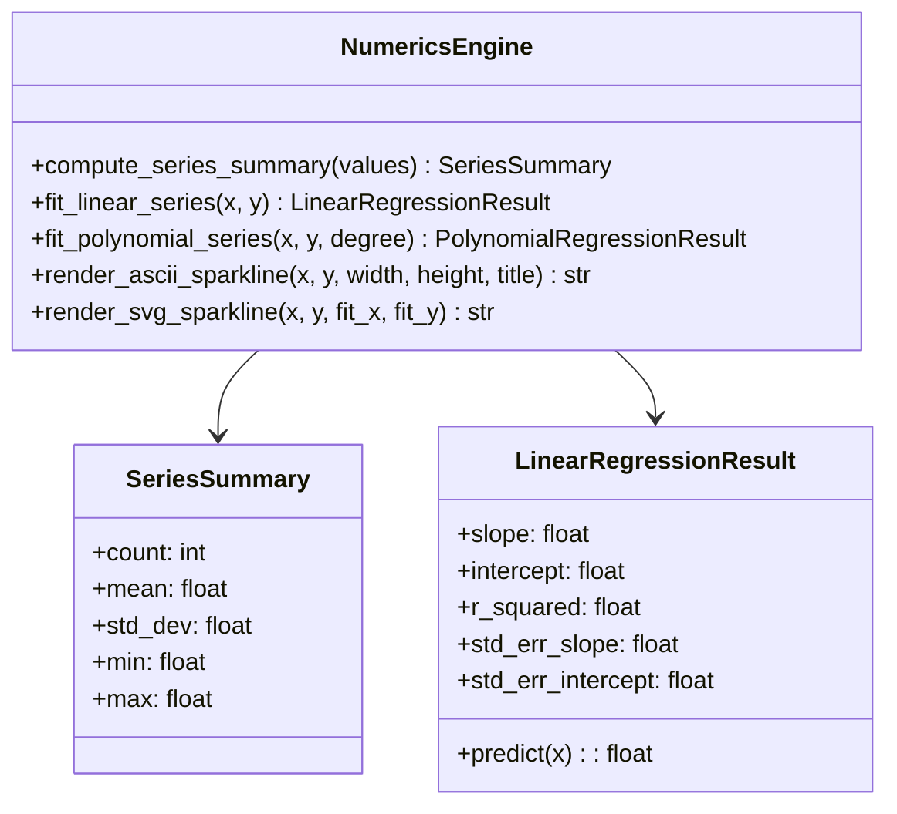
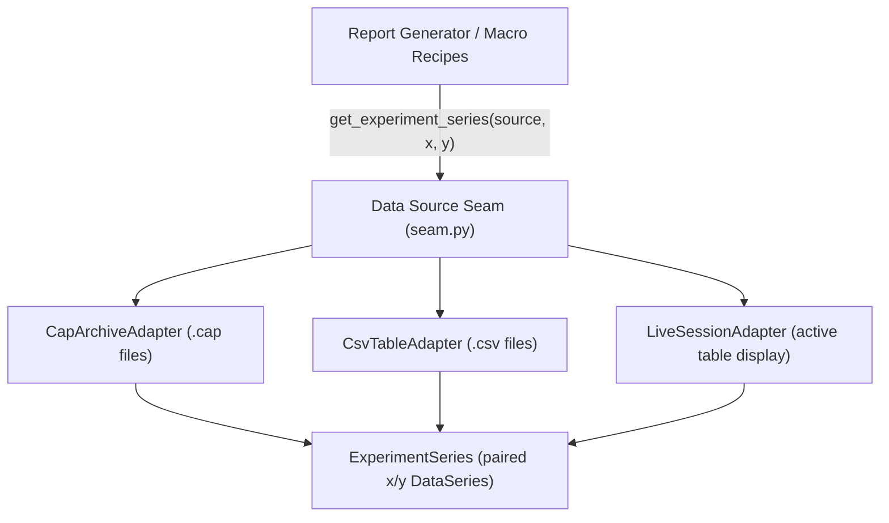
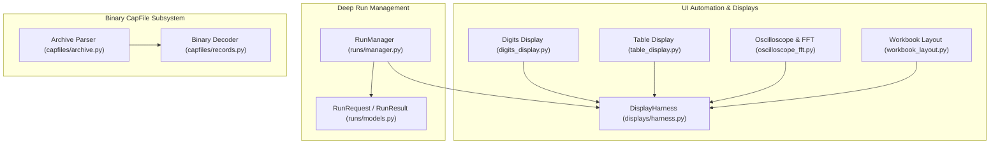
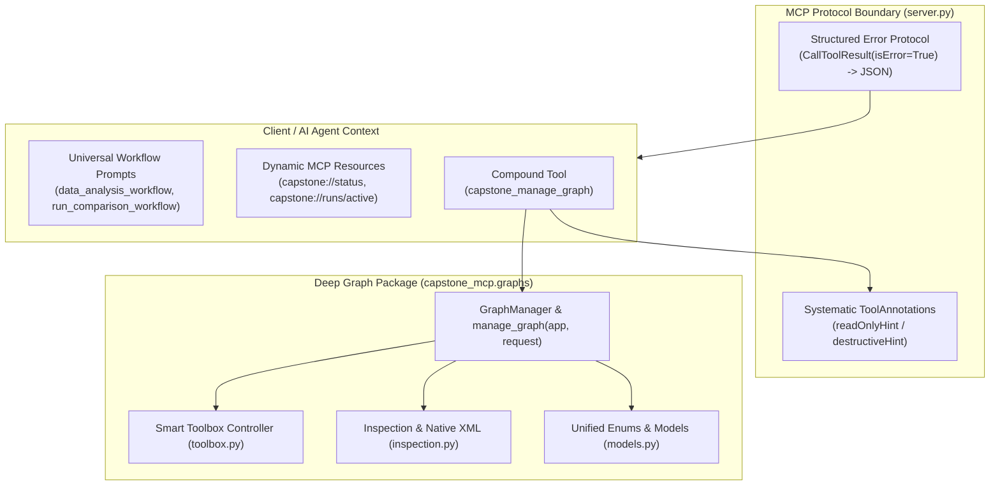
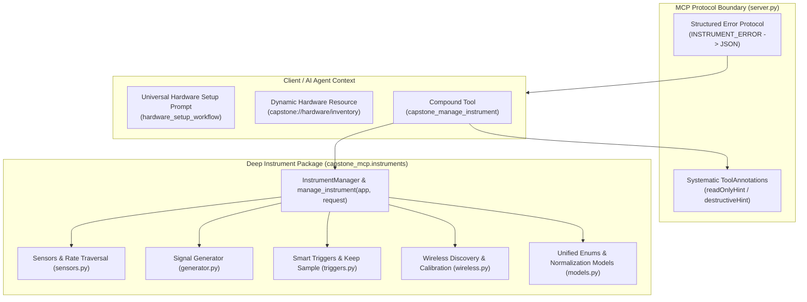

# PASCO Capstone MCP Architecture Documentation

## 1. System Overview

`capstone-mcp` is a Model Context Protocol (MCP) server providing automated control, numerical analysis, experimental data extraction, and pedagogical tutoring for **PASCO Capstone**.

### Process Architecture & Concurrency Model

PASCO Capstone is a Windows desktop application automated through UI Automation (UIA) and Component Object Model (COM) interfaces. To ensure robust reliability and prevent COM apartment thread-affinity deadlocks from blocking the asynchronous MCP protocol transport:

1. **Async FastMCP Server (`server.py`)**: Runs on the primary asyncio event loop, handling JSON-RPC transport over stdio or Streamable HTTP.
2. **Process Boundary (`automation_worker.py`)**: Manages the child worker process lifecycle with Windows Job Objects for leak-free termination (`PROCESS_ATTACH_TO_JOB`).
3. **STA Worker Loop (`native_loop.py`)**: Dedicated Single-Threaded Apartment (STA) worker process executing COM/pywinauto calls deterministically, with frame receipts (`observe_graph`) guarding against race conditions.

---

## 2. Deep Numerics Engine (`capstone_mcp.numerics`)

Prior to Phase 4, ordinary least squares (OLS) linear regression, error residual calculations, descriptive statistics, and ASCII/SVG rendering were duplicated across `analysis.py`, `experiment_analysis.py`, `plotting.py`, and `reports/generator.py`. 

The Deep Numerics Engine consolidates these capabilities into a single leaf package with zero GUI or network dependencies.

### Key Modules:
- `summary.py`: Descriptive statistics computation (`mean`, sample standard deviation, minimum, maximum).
- `regression.py`: High-precision Ordinary Least Squares (OLS) linear and polynomial regression with standard error of estimate, slope uncertainty, and coefficient of determination ($R^2$).
- `sparklines.py`: Visual ascii sparkline diagrams for CLI logs and SVG vector plots with data points and trendlines for HTML lab reports.

---

## 3. Unified Experiment Data Source Seam (`capstone_mcp.data_sources`)

To eliminate ad-hoc format branching (`.cap` vs `.csv` vs live UI table) across reports and automation recipes, `capstone_mcp.data_sources` provides a single abstraction seam.

### Models & Protocols:
- **`DataSeries`**: Immutable container for named, unit-annotated numerical series with `clean_floats()` filtering of missing or sparse values.
- **`ExperimentSeries`**: Paired independent ($x$) and dependent ($y$) variables, run metadata, and provenance tags.
- **`DataSourceAdapter` Protocol**: Common interface implemented by `CapArchiveAdapter`, `CsvTableAdapter`, and `LiveSessionAdapter`.

---

## 4. Domain Tool Routers & Server Decomposition

`src/capstone_mcp/server.py` was decomposed from a 1,948-line monolith into focused domain routers in `src/capstone_mcp/tools/`, reducing `server.py` by over 72% while preserving 100% backward compatibility across all 75 registered MCP tools:

| Domain Router | File | Responsibilities & Tools |
| :--- | :--- | :--- |
| **Files** | `src/capstone_mcp/tools/files.py` | Experiment save/open, CSV data export, dataset inspection, and file regression. |
| **Displays** | `src/capstone_mcp/tools/displays.py` | Graph creation, axis measurement assignment, graph screenshots, table displays, digits displays, workbook layout, and run management. |
| **Instruments** | `src/capstone_mcp/tools/instruments.py` | Hardware sensor configuration, discrete rate adjustments, repeat acquisition jobs, zero/tare, signal generator, oscilloscope, FFT, smart triggers, and wireless calibration. |
| **Physics** | `src/capstone_mcp/tools/physics.py` | Mathematical calculations, plotting, experiment macros (`recipes`), formal lab report generation, and interactive pedagogical tutors. |

### Retirement of `NativeDispatch` (Passing the Deletion Test)

The redundant 579-line pass-through layer `src/capstone_mcp/native_dispatch.py` was deleted. The STA worker command execution was consolidated directly into `src/capstone_mcp/native_loop.py`, removing an unnecessary intermediate abstraction layer and shortening call stacks.

---

## 5. Core Domain & Automation Deepening (Phase 5)

Phase 5 collapsed fragmented shallow utilities across run management, binary archive decoding, and display palette interactions into deep, cohesive modules with minimal external surface areas and high internal depth:

### Key Subsystems:
1. **Deep Run Management Module (`src/capstone_mcp/runs/`)**:
   - Collapsed 4 shallow modules (`run_rename.py`, `run_delete.py`, `run_visibility.py`, `run_capture.py`) into a unified `RunManager` engine.
   - Provides a single `manage_run(app, RunRequest)` seam supporting `RENAME`, `DELETE`, and `SET_VISIBILITY`.
   - Incorporates inline F2 keyboard renaming fallbacks, automated modal confirmation dialog dismissal, multi-display visibility toggling, and multi-cycle dataset acquisition snapshots with trendline comparisons.

2. **Decoupled Binary Record Decoder (`src/capstone_mcp/capfiles/records.py`)**:
   - Decoupled low-level little-endian 12-byte attribute/double scalar unpacking and 8-byte header UTF-16 text decoding from ZIP archive and XML traversal.
   - Provides pure byte-buffer decoding seams (`decode_numeric_payload`, `decode_text_records`, `decode_interval_coordinates`), enabling microsecond in-memory unit testing (`tests/test_capfile_records.py`) without synthetic zip file generation.
   - Preserves 100% backward compatibility for archive traversal in `src/capstone_mcp/capfiles/archive.py`.

3. **Consolidated Display Automation Harness (`src/capstone_mcp/displays/`)**:
   - Consolidates palette drag-and-drop operations, double-click insertion, container resolution, and click/invoke fallbacks into `DisplayHarness`.
   - Eliminated 6 duplicated `_click()` fallback definitions and repetitive `_find_*` control loops across `digits_display.py`, `table_display.py`, `workbook_layout.py`, `oscilloscope_fft.py`, and `runs/manager.py`.

---

## 6. Deep Graph Subsystem & MCP Protocol Maturity (Phase 6)

Phase 6 deepened the fragmented graph automation infrastructure into a unified domain package (`src/capstone_mcp/graphs/`), eliminated 7 shallow root modules, and upgraded the MCP protocol integration to full maturity with compound tools, systematic tool annotations, dynamic state resources, structured error envelopes, and guided workflow prompts.

### Key Architectural Enhancements:

1. **Deep Graph Domain Seam (`src/capstone_mcp/graphs/`)**:
   - Consolidated 7 fragmented shallow modules (`graph_control.py`, `graph_execution.py`, `graph_report.py`, `graph_requests.py`, `graph_state.py`, `graph_toolbox.py`, `graph_workflows.py`) into a deep, cohesive package.
   - Anchored by a single unified seam: `manage_graph(app: Capstone, request: GraphRequest) -> GraphResult` and `GraphManager` engine.
   - Encapsulates Qt floating smart toolbox (`ZSmartToolBox`) coordinates arithmetic, delta measurements, curve area integration, and summary statistics table extraction.
   - Decodes native clipboard XML state and renders pure analytical reports without cross-binding leakage.

2. **Compound FastMCP Tool (`capstone_manage_graph`)**:
   - Registers a single compound tool on FastMCP dispatching across 8 graph actions (`CREATE`, `READ`, `FIT`, `SELECT_MEASUREMENT`, `TOOLBOX_DELTA`, `TOOLBOX_AREA`, `TOOLBOX_STATISTICS`, `ANALYZE`).
   - Mitigates AI agent context bloat by reducing required tool schemas while preserving thin backward-compatible forwarding adapters for legacy tool callers.

3. **Systematic MCP Tool Annotations**:
   - Every domain tool is annotated with explicit `ToolAnnotations`:
     - `readOnlyHint=True` on non-mutating inspection tools (`capstone_windows`, `capstone_snapshot`, `capstone_screenshot`, `capstone_read_graph`, `capstone_read_table`, `capstone_inspect_file`, `capstone_file_datasets`, `capstone_linear_fit`, etc.).
     - `destructiveHint=True` on state-destroying operations (`capstone_delete_run`, `capstone_open_experiment` with discard, `capstone_set_graph_fits`, `capstone_analyze_graph`).

4. **Dynamic Real-Time State Resources**:
   - `capstone://status`: Live JSON snapshot of Capstone process attachment, window count, active background jobs, and worker health.
   - `capstone://runs/active`: Real-time active job and recording run state for immediate agent inspection without heavy round-trip RPC calls.

5. **Standardized Error Protocol**:
   - Replaced raw unhandled Python tracebacks with structured `CallToolResult(isError=True)` containing structured JSON envelopes (`error_code`, `message`, `remediation`).
   - Provides clear, actionable self-correction instructions across AI agent interactions for unattached sessions, missing controls, graph errors, and argument validation issues.

6. **Universal Workflow Prompts**:
   - `data_analysis_workflow`: End-to-end guided prompt for display inspection, graph reading, curve fitting, residual analysis, and formal lab report generation.
   - `run_comparison_workflow`: Multi-run comparative prompt for verifying recorded trials, extracting summary statistics, and computing percentage differences.

---

## 7. Deep Instrument Subsystem & Hardware Compound Tooling (Phase 7)

Phase 7 deepened and consolidated the fragmented hardware and instrument automation utilities into a cohesive domain package (`src/capstone_mcp/instruments/`), deleted 5 obsolete shallow root modules, and introduced a unified compound tool, systematic tool annotations, dynamic hardware inventory resources, structured error envelopes, and guided hardware setup workflow prompts.

### Key Architectural Enhancements:

1. **Deep Instrument Domain Seam (`src/capstone_mcp/instruments/`)**:
   - Consolidated 5 shallow root modules (`sensor_settings.py`, `sensor_zero.py`, `signal_generator.py`, `smart_triggers.py`, `wireless_calibration.py`) into a deep, cohesive package.
   - Anchored by a single unified functional seam: `manage_instrument(app: Capstone, request: InstrumentRequest) -> InstrumentResult` and `InstrumentManager` engine.
   - Dispatches across 9 discrete hardware actions: `SET_SAMPLING_RATE`, `ZERO_SENSOR`, `CONFIGURE_SIGNAL_GENERATOR`, `SET_RECORDING_CONDITION`, `SET_SAMPLING_MODE`, `KEEP_SAMPLE`, `SCAN_WIRELESS`, `CONNECT_WIRELESS`, and `CALIBRATE_SENSOR`.
   - Incorporates ergonomic flat argument normalization (`_FLAT_FIELD_MAPPINGS`) enabling callers and AI agents to invoke operations without complex nested dictionary schemas.

2. **Compound FastMCP Tool (`capstone_manage_instrument`) & Thin Forwarding Adapters**:
   - Registers a single compound tool on FastMCP dispatching across all 9 instrument actions via `request: InstrumentRequest`.
   - Dramatically reduces AI agent context footprint and tool schema overhead while preserving thin backward-compatible forwarding adapters for all legacy tool callers (`capstone_zero_sensor`, `capstone_set_signal_generator`, etc.).

3. **Systematic Tool Annotations**:
   - All 24 instrument tools are explicitly annotated with `ToolAnnotations`:
     - `readOnlyHint=True` on non-mutating query tools (`capstone_recording_status`, `capstone_read_signal_generator_status`, `capstone_scan_wireless_sensors`).
     - `readOnlyHint=False` on state-altering actuators (`capstone_zero_sensor`, `capstone_set_signal_generator`, `capstone_calibrate_sensor`).

4. **Dynamic Real-Time Hardware Resource**:
   - `capstone://hardware/inventory`: Real-time JSON snapshot providing connected interfaces, sensor states, and wireless status. Includes deterministic offline fallbacks when Capstone is unattached.

5. **Structured Hardware Error Envelope & Universal Setup Prompt**:
   - Classifies hardware/sensor/calibration failures into `INSTRUMENT_ERROR` with structured JSON payloads and actionable remediation advice.
   - `hardware_setup_workflow`: 6-step prompt guiding agents through interface verification, wireless pairing, sampling rate configuration, sensor zero/tare, and signal generator initialization.

---

## 8. Quality & Verification Guardrails

1. **Automated Test Coverage**: 476 unit and integration tests across 57 test suites, executed with `uv run --no-sync pytest` (100% pass rate).
2. **Deterministic Offline CI**: Hardware-dependent and live GUI tests include fallback guards (`pytest.mark.skipif`), allowing CI pipelines to pass deterministically in headless environments.
3. **Windows Process Lock Guard**: Tool and test runner commands strictly enforce `--no-sync` to avoid `os error 32` file locking when background MCP processes hold `capstone-mcp.exe`.
4. **Strict Type Safety & Linting**: Ruff compliance across all rulesets (`ruff check src tests`) with 0 errors, and Basedpyright type validation (`basedpyright src`) with 0 errors, 0 warnings.

