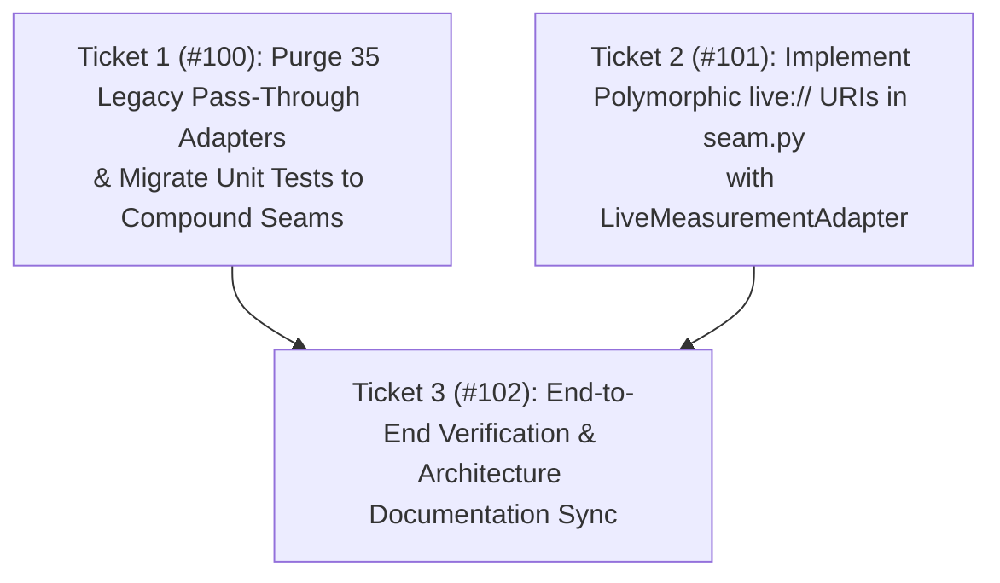

# Phase 10: Codebase Deepening & Polymorphic Seam Unification

- **상태 (Status)**: 승인됨 (Approved)
- **일자 (Date)**: 2026-11-13
- **근거 문서 (Governing ADRs)**:
  - [ADR 0001: Tool Surface, IPC Diagnostic Pipeline, and Educational Scope Excision](docs/adr/0001-tool-surface-and-ipc-diagnostics.md)
  - [ADR 0002: Bridge Unification, Live Smoke Tests, and Run Domain Consolidation](docs/adr/0002-bridge-unification-and-runtime-verification.md)
  - [ADR 0003: CDP Primary Telemetry and UIA Auxiliary Fallback](docs/adr/0003-cdp-primary-telemetry-and-uia-fallback.md)

---

## 1. Problem Statement (문제 정의)

1. **레거시 패스스루 함수의 잔존 (Shallow Module Debt)**:
   - Phase 9에서 FastMCP에 노출되는 도구를 21개로 제한했으나, `src/capstone_mcp/tools/displays.py`와 `instruments.py` 내부에는 여전히 35개의 레거시 개별 함수(`capstone_create_table`, `capstone_create_digits`, `capstone_zero_sensor`, `capstone_set_signal_generator` 등)가 약 600줄에 걸쳐 잔존해 있음.
   - 이 함수들은 오직 과거 단위 테스트들의 수입(import)을 유지하기 위해서만 존재하며, 도메인 Seam의 내부 구현을 은닉하지 못하고 테스트 표면을 이원화하고 있음 (*The Interface is the Test Surface 위반*).

2. **데이터 소스 Seam의 다형성 단절 (Broken Polymorphic Seam)**:
   - `capstone_mcp.data_sources.seam.py`의 `get_experiment_series(source, ...)`는 파일 경로(`.cap`, `.csv`)만 지원함.
   - 라이브 세션은 호출자가 직접 `ReadTableResult` UIA 화면 객체를 획득한 뒤 `LiveSessionAdapter`를 별도로 인스턴스화해야 하므로, 보고서 생성기 및 피팅 엔진이 단일 인터페이스 뒤에서 파일과 실시간 데이터를 일관되게 질의할 수 없음.

---

## 2. Architecture & Design Principles (설계 원칙)

1. **The Deletion Test (완전 삭제)**:
   - `tools/displays.py` 및 `tools/instruments.py`에서 35개 레거시 개별 함수를 전량 삭제함.
   - 도메인 패키지의 복합 Seam(`manage_display`, `manage_graph`, `manage_instrument`, `manage_run`)만이 유일한 진입점 인터페이스가 됨.

2. **The Interface is the Test Surface (테스트 표면 일원화)**:
   - 삭제된 함수들을 호출하던 약 120개의 단위 테스트들을 `manage_display(app, DisplayRequest(action=..., ...))` 및 `manage_instrument(app, InstrumentRequest(action=..., ...))`를 직접 검증하도록 전면 마이그레이션함.

3. **Two Adapters Justify the Seam (다형성 `live://` Seam)**:
   - `data_sources/seam.py`에 `live://` URI 파서를 내장:
     - `live://measurements`: CDP WebSocket Fast-Path를 통해 실시간 센서 인벤토리 및 계측값 스트림에서 `ExperimentSeries` 생성 (`LiveMeasurementAdapter`).
     - `live://table`: 활성 Table 디스플레이에서 열 이름 매칭을 통해 `ExperimentSeries` 생성 (`LiveSessionAdapter`).
   - 호출자는 소스가 디스크 파일인지 실시간 라이브 세션인지 알 필요 없이 오직 문자열 URI 하나(`source="live://measurements"`)로 데이터를 질의함.

---

## 3. Work Breakdown & Tracer-Bullet Tickets (티켓 분할)

- **Master Spec Issue**: [#99](https://github.com/ji5zi5/capstone-mcp/issues/99)

### Ticket 1 (#100): Purge 35 Legacy Pass-Through Adapters & Migrate Tests to Compound Seams
- **Files**: `src/capstone_mcp/tools/{displays,instruments,files,physics}.py`, `tests/test_{displays,instruments,table_display,digits_display,oscilloscope_fft,signal_generator,sensor_settings,sensor_zero,smart_triggers,wireless_calibration}.py`
- **What to build**:
  - `src/capstone_mcp/tools/displays.py`: 19개 레거시 개별 함수 완전 삭제 (`capstone_create_digits`, `capstone_create_table`, `capstone_set_table_columns`, `capstone_read_table`, `capstone_create_scope`, `capstone_create_fft`, `capstone_read_fft_peaks`, `capstone_add_page`, `capstone_set_page_layout` 등).
  - `src/capstone_mcp/tools/instruments.py`: 23개 레거시 개별 함수 완전 삭제 (`capstone_set_sampling_rate`, `capstone_zero_sensor`, `capstone_set_signal_generator`, `capstone_scan_wireless_sensors`, `capstone_connect_wireless_sensor`, `capstone_calibrate_sensor`, `capstone_set_recording_condition`, `capstone_keep_sample` 등).
  - `src/capstone_mcp/tools/files.py`: 미등록 보조 함수(`csv_page`, `fit_file`, `compare_file`) 정리.
  - 관련 단위 테스트 스위트를 도메인 `manage_*` 함수 직접 호출로 100% 마이그레이션.
- **Acceptance Criteria**:
  - `tools/displays.py`와 `tools/instruments.py`에 오직 `@mcp.tool`이 달린 복합 함수만 남음 (~600줄 감축).
  - 527개 전체 테스트 스위트 100% 패스.
  - `ruff` 및 `basedpyright` 0 errors.

### Ticket 2 (#101): Implement Polymorphic `live://` URIs in `data_sources/seam.py`
- **Files**: `src/capstone_mcp/data_sources/seam.py`, `src/capstone_mcp/data_sources/adapters/{__init__.py, live_telemetry.py, live_session.py}`, `tests/test_data_sources.py`
- **What to build**:
  - `LiveMeasurementAdapter` 신설: `UnifiedSessionManager`의 `read_live_inventory` 및 `read_live_measurement`를 사용하여 x(예: Time 또는 샘플 인덱스), y(센서 측정값)의 `ExperimentSeries` 생성.
  - `seam.py`의 `list_source_datasets(source)` 및 `get_experiment_series(source, x_name, y_name)` 확장:
    - `source.startswith("live://")` URI 지원.
    - `live://measurements`: `LiveMeasurementAdapter` 디스패치.
    - `live://table`: `LiveSessionAdapter` 디스패치.
    - Capstone 미구동 시 명확한 `ValueError("Capstone is not running for live source: ...")` 발생.
- **Acceptance Criteria**:
  - `get_experiment_series("live://measurements", "time", "force")` 호출이 정상 작동.
  - `list_source_datasets("live://measurements")`가 연결된 센서 데이터셋 메타데이터 목록을 반환.
  - 단위 테스트 `tests/test_data_sources.py`에 `live://` URI 검증 추가.

### Ticket 3 (#102): End-to-End Verification & Architecture Documentation Sync
- **Files**: `docs/architecture.md`, `README.md`, `GLOSSARY.md`, `tests/test_live_smoke.py`
- **What to build**:
  - `docs/architecture.md`에 Phase 10 코드베이스 심화 및 다형성 `live://` Seam 아키텍처 다이어그램 반영.
  - `tests/test_live_smoke.py`에 `get_experiment_series("live://measurements", ...)` 실물 스모크 테스트 추가.
  - 전체 회귀 테스트 통과 및 GitHub Actions CI 검증.
- **Acceptance Criteria**:
  - 527+개 테스트 100% 패스.
  - Ruff / Basedpyright 0 errors.
  - CI `completed: success`.
